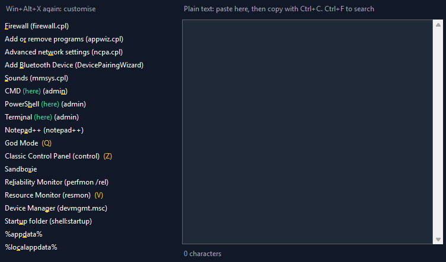
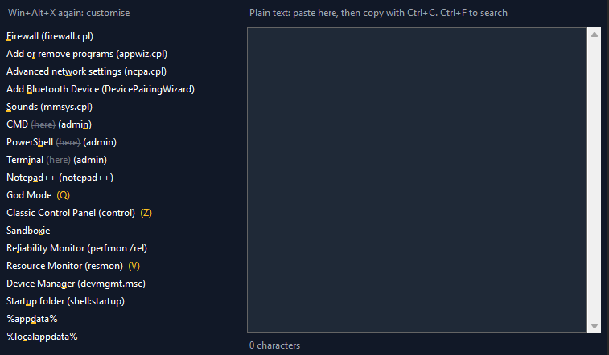
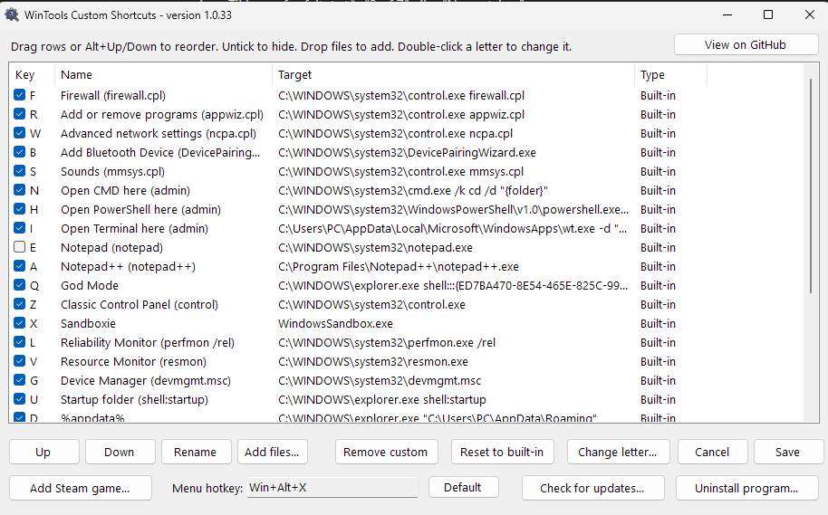

A small keyboard menu for Windows 11. Press **Win+Alt+X**, then a letter.

| Opened over a folder: "(here)" is green | Opened elsewhere: "(here)" is struck out |
|---|---|
|  |  |

## Install

Download **WinToolsMenu-{version}.zip** below, unzip it and double-click `install.cmd`. Then press Win+Alt+X. Already installed? Click "Update to {version}" at the bottom of the menu.

## New since 1.0.31

- **CMD / PowerShell / Terminal (here):** "(here)" is green when the menu is opened over an Explorer folder or the desktop, and the console opens there. Anywhere else "(here)" is grey and struck out, and the console opens in its usual folder.
- **Search the text pad:** Ctrl+F opens a search box above the text. Enter jumps to the next match, Shift+Enter to the previous one, and the box shows where you are ("3 of 7"). Esc closes it.

## Features

- **One hotkey, one letter:** Win+Alt+X opens the menu at the mouse; a letter starts the item. Click works too.
- **Windows tools close at hand:** Firewall, Add or remove programs, network settings, Bluetooth, Sounds, Device Manager, Resource and Reliability Monitor, Classic Control Panel, God Mode, Startup and AppData folders, and more.
- **CMD, PowerShell or Terminal (here):** in the Explorer folder under the mouse (or the usual folder), as administrator or not.
- **Plain text pad:** paste text to strip its formatting, edit it, and copy it back with Ctrl+C. Shows the character count.
- **Search the text:** Ctrl+F in the pad, Enter / Shift+Enter for the next / previous match.
- **Customise the menu:** add your own programs, scripts, files, folders, web addresses and Steam games; rename, hide, reorder and change letters; change the hotkey. Press Win+Alt+X again while the menu is open.
- **Installs missing tools:** offers to install Notepad++ and turn on Windows Sandbox (or install Sandboxie-Plus on Windows Home).
- **Updates itself** from GitHub, and can uninstall itself.

See the [README](https://github.com/donkeyhigh/WindowsMenuTool#readme) for the full list of built-in items.

Use it at your own risk (MIT license, no warranty).
